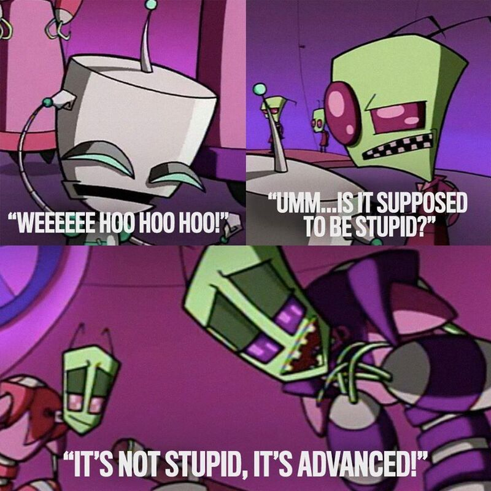

# Advanced Marketing

As major AI companies start filing IPOs or delay releases of their new models, one has to wonder how executives are inflating the value of their products.

"It's not stupid, it's advanced" is one of my favorite lines from the show.

In addition to the meme below, when Zim suggests that Gir looks broken, The Tallest reply, "That's what the enemy will think!".

The Tallest know how to do marketing.

