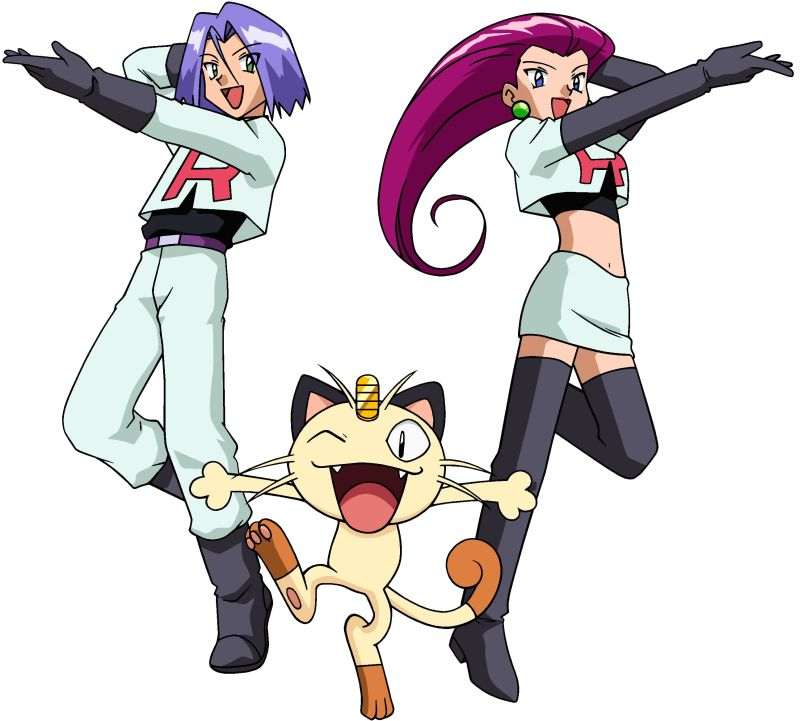

# Ideal Team

"Tell me about your ideal team. Where would you thrive?" Have you heard this interview question? You're about to get the best answer.

Oh ho ho... Prepare for Trouble!

Team Rocket is my ideal team.

1. **Diversity**. 1/3 female, 1/3 cat, 1/3 James. IYKYK.

2. **Creativity**. The latest attempt to capture Pikachu didn't work. That's ok! We have seasons worth of new ideas!

3. **Funding**. They get to play with the latest in technology, including many mechs dedicated to capturing one kid's favorite Pokemon. And if it blows up, that's ok! There are more where that came from. Moral questions surrounding the funding? Perhaps, but hey, it's a stable job.

4. **Enjoyment**. They love what they do, even if it doesn't involve a win. They have the motivation to keep going, get right back up to try again, and they smile while doing it.

5. **Rhyme**. They have their own proprietary introduction. Something that you immediately correlate with the Team Rocket brand. Marketing never came so cheap.

6. **Costumes**. Enough said.

Perfect team? Doesn't matter. I'd have a **blast** with them. :rocket:

