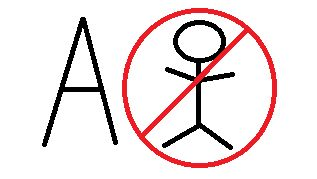

# Misanthropic

It's no surprise that I prefer plants and animals to people.

That's why I'm excited to announce that I'm founding a new nonprofit AI company.

MISANTHROPIC

Our mission is to improve the lives of all nonhumans through responsible AI usage.

No data centers. Powered by 100% sustainably harvested vitriol.

Our flagship product is called Fraude. You can ask Fraude important questions like, "What's the word for someone who hates people?", "What is Anthropic's main product?", or "What is Anthropic's logo?"

Then you'll get the jokes. 🙄

